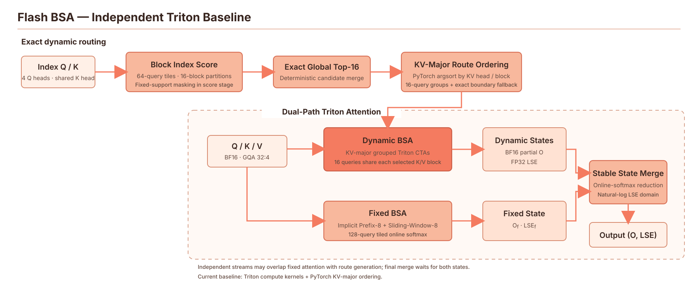

# Flash BSA: Triton Baseline and CuTeDSL Optimized Path


Flash BSA is an independently authored Triton implementation of block-sparse
grouped-query attention for long-context prefill. It uses a shared KV-block
abstraction across routing, sparse execution, and state reduction while
preserving exact dynamic Top-K semantics.

The repository contains both a PyTorch executable specification and a GPU
baseline. The PyTorch path defines the numerical contract; the Triton path
implements the router, fixed attention, KV-major dynamic attention, and
online-softmax state merge.

The `aip/maxwell-v1-flash-bsa-cutedsl` branch additionally carries the
`cutedsl-opt1` optimized path. It replaces Index Score generation and both
levels of exact Top-K selection with CuTeDSL kernels while retaining the
qualified Fixed BSA, Dynamic MSA, K2 combine, and CUDA CSR/LPT runtime.
The original Triton baseline remains available as the numerical oracle and
fallback implementation.

See [docs/CUTEDSL_OPT1.md](docs/CUTEDSL_OPT1.md) for its execution contract,
validated performance, reproduction command, and source boundary.
[docs/CUTEDSL_OPT2.md](docs/CUTEDSL_OPT2.md) tracks the production-coverage
extension, beginning with non-identity Index-K page tables and partial KV
tails.

<p align="center">
  
</p>

## Highlights

| Capability | Baseline implementation |
|---|---|
| Block-level routing | 128-token KV blocks |
| Exact selection | Partition candidates followed by exact global Top-16 |
| Fixed support | Position-derived Prefix-8 and Sliding-Window-8 |
| Dynamic execution | KV-major route ordering with 16-query grouped CTAs |
| Numerical reduction | FP32 online-softmax states and stable LSE merge |
| Index layout | Four Index-Q heads sharing one Index-K head |
| Source boundary | Independently authored PyTorch and Triton code only |

## Execution Design

### Exact hierarchical routing

The score kernel evaluates query-to-block relevance with 64-query tiles and
16-block partitions. A block score is the maximum token score within that KV
block. Prefix, local-window, and causally invisible blocks are masked before
candidate publication. A second Triton kernel performs an exact global
Top-16 merge, so the resulting route matches direct global selection.

### Dual-path sparse attention

The fixed path derives Prefix-8 and Sliding-Window-8 directly from logical
positions and maintains its online-softmax state in FP32. It does not
materialize a fixed sparse route.

The dynamic route is ordered by `(KV head, KV block)`. Consecutive queries
selecting the same block are grouped in sets of 16, allowing one Triton CTA to
reuse the corresponding K/V block across multiple queries and their eight GQA
heads. Groups crossing a KV-row boundary use an exact fallback path.

The final kernel combines the fixed state with all dynamic partial states in
the log-sum-exp domain and writes the final output and LSE.

> **Scope.** This baseline is a coordinated multi-kernel implementation. It
> does not claim a single physical MegaKernel, TMA mainloops, persistent CTA
> scheduling, or a fully Triton-native route sorter.

## Supported Baseline Configuration

| Parameter | Value |
|---|---:|
| Batch size | 1 |
| Query / KV heads | 32 / 4 |
| GQA group size | 8 |
| Head dimension | 128 |
| Query dtype | BF16 |
| KV block size | 128 tokens |
| Fixed blocks | Prefix-8 + Sliding-Window-8 |
| Dynamic blocks | Exact Top-16 |
| Validated query chunk | 8192 tokens |
| Query offset | 128-token aligned |

## Requirements

- Python 3.10 or later
- PyTorch with CUDA support
- Triton 3.6 or a compatible release
- A CUDA GPU with BF16 Tensor Core support

No compiled extension or external attention package is required.

The statement above applies to the independent Triton baseline. The
`cutedsl-opt1` path requires NVIDIA CuTeDSL/CUTLASS and builds its vendored
CUDA CSR/LPT extension at runtime.

## Python API

```python
import torch

from compass_bsa import gpu_pipeline_v2

# index_q: [Q, 4, 128]
# index_k: [KV, 1, 128]
# q:       [Q, 32, 128]
# k, v:    [KV, 4, 128]
output, lse, route = gpu_pipeline_v2(index_q, index_k, q, k, v)
```

`route` has shape `[4, Q, 16]`, `output` has shape `[Q, 32, 128]`, and
`lse` has shape `[Q, 32]`.

## Correctness

The GPU router is checked against a materialized dense block-score oracle.
The attention output is checked against direct attention over the exact union
of fixed and dynamically selected blocks.

| Check | B300 result |
|---|---:|
| Top-K route indices | Exact match |
| Router score max absolute error | `1.1444e-5` |
| Output max absolute error | `4.8089e-4` |
| LSE max absolute error | `9.5367e-7` |

## B300 Performance

BF16, Q=8192, Hq=32, Hkv=4, D=128, Prefix-8, Sliding-Window-8,
Dynamic Top-16. Timings use CUDA events, three warmups, and the median of
seven samples.

| KV length | Router | KV order | Fixed | Dynamic | Merge | End-to-end |
|---:|---:|---:|---:|---:|---:|---:|
| 8K | 0.547 ms | 0.449 ms | 1.402 ms | 1.431 ms | 0.414 ms | **4.098 ms** |
| 32K | 1.045 ms | 0.439 ms | 1.415 ms | 1.621 ms | 0.416 ms | **4.787 ms** |
| 64K | 1.666 ms | 0.431 ms | 1.414 ms | 1.856 ms | 0.416 ms | **5.641 ms** |

These measurements qualify the independent baseline; they are not presented
as the final performance target.

## Reproduce

Run the source-boundary check and CPU semantic tests:

```bash
python3 tools/check_independence.py
python3 -m unittest discover -s tests -v
```

Run correctness and latency gates on a CUDA host:

```bash
CUDA_VISIBLE_DEVICES=0 \
TRITON_CACHE_DIR=/tmp/flash_bsa/triton \
python3 bench/bench_triton_baseline.py \
  --revision 2 \
  --kv 8192,32768,65536 \
  --warmups 3 \
  --samples 7
```

## Repository Layout

```text
compass_bsa/
  router.py       PyTorch exact-routing specification
  attention.py    PyTorch attention and state-merge specification
  csr.py          KV-centric CSR and work-order specification
  gpu.py          Triton exact router and revision-1 reference
  gpu_v2.py       Tiled fixed path, grouped dynamic path, and state merge
  pipeline.py     End-to-end semantic pipeline
bench/
  bench_triton_baseline.py
tests/
  test_independent_v1.py
tools/
  check_independence.py
docs/
  CUTEDSL_OPT1.md
  CUTEDSL_OPT2.md
  TRITON_BASELINE.md
  flash_bsa_execution.svg
```

See [docs/TRITON_BASELINE.md](docs/TRITON_BASELINE.md) for implementation
details, workspace costs, known limitations, and the optimization roadmap.

## Source Provenance

The `compass_bsa/` Triton baseline remains independently authored. The
optimized path includes attributed third-party MSA and BSA runtime sources;
their original license, notice, and copyright files are preserved. See
[PROVENANCE.md](PROVENANCE.md) for the precise source boundary.
