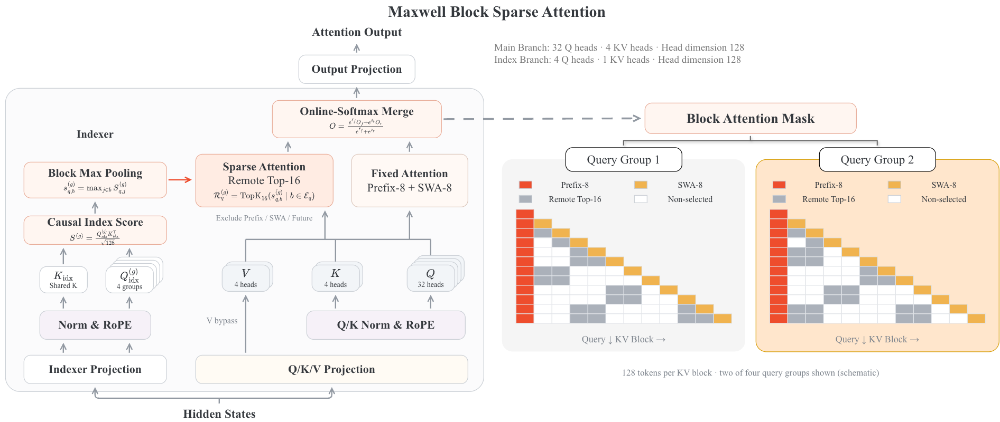

# Maxwell Block Sparse Attention (MBSA)

MBSA implements block-sparse **prefill** attention with a pinned Hugging Face Python oracle, a Triton precision baseline and CuTe DSL kernels. The package is `mbsa`. This code supports the Maxwell-V1-Flash Model.



The Indexer selects **Remote Top-16** blocks independently for four KV groups. Two Attention paths share main Q/K/V: **Fixed Attention** over **Prefix-8 + SWA-8**, and **Remote Attention** over selected blocks. FP32 softmax-state reduction combines their outputs and natural-log LSE. Routing uses the maximum eligible token dot product in each block, scaled by `128**-0.5`, without ReLU; remote selection excludes Fixed support.

## Supported configuration

| Item | Configuration |
| --- | --- |
| Main Attention | Q/KV heads=32/4, GQA=8, HeadDim=128; BF16 Q/K/V and output |
| Indexer | Q/K heads=4/1, HeadDim=128 |
| Model block mask | Block128; Prefix-8 + SWA-8 + Remote Top-16 |
| H100 / SM90 Index | Native BF16 or FP8 E4M3; MX explicitly unsupported |
| SM100-family Index | Native BF16, FP8 E4M3 or MXFP8 × MXFP6 |
| Model partial states | BF16 or FP8 E4M3; FP32 LSE and reduction |
| MSA-compatible CSR | Block32/64/128, TopK4/8/16/32, FP32/BF16/FP16/FP8 partials |
| Request layout | Batch-one, packed varlen, paged KV and interleaved K/V |
| Execution | Eager, prepared CUDA graph and same-geometry tensor rebinding |

Other Attention head configurations are unsupported. MBSA executes prefill tokens only; mixed schedules reserve decode tokens to construct prefill shapes under the shared 8192-token budget. Index operands feed native tensor-core multiplication directly, without software decoding, scalar boundary recomputation or HF runtime fallback.

## Installation

Python >=3.10 and PyTorch >=2.5 are required.

```bash
pip install -e .
pip install -e '.[triton,cutedsl,dev]'
```

Blackwell CSR construction requires a CUDA toolkit with `nvcc`. Hopper uses CuTe DSL and QuACK without a CUDA C++ extension. Importing `mbsa` loads accelerator dependencies only when a backend is requested.

| Tested stack | H100 / SM90 | B300 / physical SM103 |
| --- | --- | --- |
| PyTorch | 2.9.1+cu126 | 2.11.0+cu130 |
| Triton | 3.5.1 | 3.6.0 |
| CuTe DSL | 4.8.0.dev0 | 4.6.0 |
| QuACK | 0.6.2 | 0.6.3 |

SM100 policy validation was performed on B300 with the default physical compilation target. These measurements do not constitute B200/GB200 hardware validation.

## Usage

Inputs are post-RoPE NHD tensors. The caller supplies projections, normalization, RoPE and KV-cache management.

```python
import torch
from mbsa import reference_pipeline, triton_pipeline, prepare_cutedsl_pipeline

Q, KV = 128, 8192
index_q = torch.randn(Q, 4, 128, device='cuda', dtype=torch.bfloat16)
index_k = torch.randn(KV, 1, 128, device='cuda', dtype=torch.bfloat16)
q = torch.randn(Q, 32, 128, device='cuda', dtype=torch.bfloat16)
k = torch.randn(KV, 4, 128, device='cuda', dtype=torch.bfloat16)
v = torch.randn_like(k)

out, lse, route = reference_pipeline(index_q, index_k, q, k, v)
out, lse, route = triton_pipeline(index_q, index_k, q, k, v)
plan = prepare_cutedsl_pipeline(index_q, index_k, q, k, v)
out, lse, route = plan.run()
```

Output is `[Q,32,128]`, FP32 LSE is `[Q,32]`, and remote IDs are `[4,Q,16]` with `-1` padding. The Python oracle accepts CPU tensors. The Triton baseline uses batch-one tensors and requires `(KV-Q) % 128 == 0`.

Preparation validates geometry, allocates workspace and compiles kernels. Subsequent `run()` calls reuse the plan. A runnable example is provided alongside the CuTe interface:

```bash
python -m mbsa.cute.example --backend reference
python -m mbsa.cute.example --backend cutedsl --check
```

### Packed varlen and paged KV

```python
plan = prepare_cutedsl_pipeline(
    index_q, index_k_pages, q, key_pages, value_pages,
    cu_seqlens_q=cu_q, cu_seqlens_k=cu_k,  # CUDA int32 [B+1]
    index_page_indices=index_pages,       # logical -> physical Index-K pages
    page_table=page_table,                # logical -> physical main K/V pages
    partial_dtype=torch.bfloat16,
)
out, lse, route = plan.run()
```

Main pages are `[pages,4,128,128]`. An interleaved pool `[pages,128,4,2,128]` supplies strided K/V views without copying the complete cache. Page indices remain request-local logical block IDs.

| Index format | Index Q | Index K pages | Q scales |
| --- | --- | --- | --- |
| BF16 | BF16 `[T,4,128]` | BF16 `[pages,1,128,128]` | None |
| FP8 | E4M3FN `[T,4,128]` | E4M3FN `[pages,1,128,128]` | None |
| MX | E4M3FN/uint8 `[T,4,128]` | uint8 `[pages,1,128,100]` | int32 `[T,>=4]`, four UE8M0 bytes per word |

Native MX inputs can be supplied directly. The test codecs `quantize_q_mxfp8` and `quantize_index_k_mxfp6` in `mbsa.index_formats` construct matching inputs; each 32 features share a scale. MX K pages contain 12,288 packed FP6-code bytes followed by 512 scale bytes, rather than interleaved per-token records. Test oracle decoding stays outside the runtime and performance measurement.

`plan.rebind(...)` requires identical geometry, strides, dtypes, devices and request lengths; MX rebinding also supplies `index_q_scales`. Stable tensors can be updated with `copy_()`. `plan.plan.capture_mega_graph()` and `run_mega()` capture/replay the prepared pipeline. Explicit `partial_dtype` overrides `MBSA_FP8_PARTIAL_OUT=0/1`.

`mbsa.sparse_fmha_adapter.PagedPrefill` accepts paged caches, request lengths and optional output storage. It caches plans and stages stable-address graph inputs, including page maps and MX scales. Cache keys include lengths, dtype, shape, stride and device; new geometry is prepared outside capture. The caller provides valid page IDs and serializes calls on each device. This interface performs operator-level prefill and does not claim full serving-model qualification.

### MSA-compatible sparse operators

```python
from mbsa.sparse import build_k2q_csr, sparse_atten_func

# q2k: int32 [4,total_q,topK], request-local block IDs, -1 padding
row_ptr, query_ids = build_k2q_csr(
    q2k, cu_q, cu_k, 128, total_k=total_k, max_seqlen_k=max_k,
)
out, lse = sparse_atten_func(
    q, k, v, row_ptr, query_ids, topK,
    cu_seqlens_q=cu_q, cu_seqlens_k=cu_k,
    max_seqlen_q=max_q, max_seqlen_k=max_k,
    causal=True, return_softmax_lse=True,
)
```

The CSR operator supports caller workspace, initial state, separate `MSA`/`COMBINE` phases and temperature LSE. Split phases combined with temperature LSE are rejected, following MSA. Hopper temperature other than 1 requires a second attention pass. Blackwell CSR initial state retains MSA's batch-one restriction; the model pipeline handles packed Fixed/Remote merging separately.

## Tests and benchmarks

```bash
python -m unittest discover -s tests -v
python benchmarks/bench_precision.py --hf-source /path/to/modeling_attention.py --output /tmp/mbsa-precision
python benchmarks/bench_sparse_attention_ops.py --hf-source /path/to/modeling_attention.py --output /tmp/mbsa-performance
python scripts/qualify_arch.py --mode regression
python -m build
python -m tests.smoke.test_packaging --wheel dist/mbsa-0.1.0-py3-none-any.whl
```

Tests and benchmarks use a [shared configuration](tests/config.json) to evaluate correctness and performance across supported formats and GPU architectures. Results are saved to the directory specified by `--output`.


The supplied performance comparison is provided for reference.

## Source layout

```text
python/mbsa/
  api.py                      prepared model pipeline and architecture dispatch
  reference.py                pinned HF Python oracle
  triton_backend.py           Triton precision baseline
  sparse.py                   MSA-compatible CSR interface
  sparse_fmha_adapter.py       paged-prefill integration
  index_formats.py            native Index cache codecs and test oracle helpers
  cute/
    example.py                runnable prefill example
    interface.py              Blackwell sparse forward
    prefill.py                Fixed/Remote orchestration
    sparse_index_utils.py     CSR construction
    src/common/               shared CuTe helpers
    src/sm90/                 Hopper kernels
    src/sm100/                Blackwell kernels and Fixed Attention
  third_party/                required component licenses and notices
benchmarks/                   precision and sparse Attention benchmarks
scripts/                      architecture validation entry point
tests/{smoke,regression,integration}/
docs/                         architecture and supplied performance figures
```

## License and attribution

Original MBSA code is licensed under [Apache-2.0](LICENSE). Third-party code retains its original licenses and copyright notices; see [NOTICE](NOTICE).

[NOTICE](NOTICE) records source attribution and adaptations. Component licenses and notices remain under `python/mbsa/third_party/`. MBSA derives sparse-forward components from [MiniMax MSA](https://github.com/MiniMax-AI/MSA) and retains the existing Fixed BSA snapshot. GPU kernels use [CUTLASS / CuTe DSL](https://github.com/NVIDIA/cutlass) and [QuACK](https://github.com/Dao-AILab/quack). The Python oracle and original Triton baseline retain their original copyright notices.
