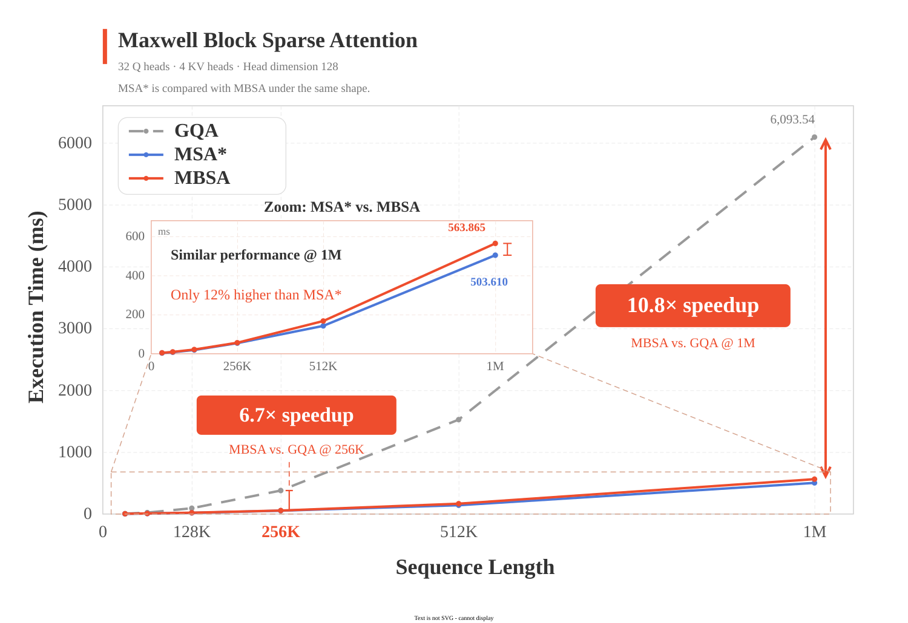

# Maxwell Block Sparse Attention (MBSA)

MBSA is a GPU kernel library for long-context block-sparse prefill attention on
NVIDIA Hopper and Blackwell. It combines prefix, sliding-window and dynamically
selected blocks to reduce attention work while keeping causal masking.

- Paged and contiguous KV caches, packed requests and partial query/KV blocks.
- BF16 attention, plus backend-specific FP8 KV support on Blackwell.
- BF16, FP16 or FP8 Index routing; native MXFP6 indexing on Blackwell.
- Reusable prepared plans, CUDA Graph replay and Fixed/Index routing overlap.
- Optional FP8 partial outputs and a serving interface for model integration.

Current geometry: 32 query heads, 4 KV heads, head dimension 128 and 128-token
blocks. Each request chunk contains at most 8192 query tokens.

## Architecture

Fixed attention covers prefix and local blocks; Dynamic attention selects remote
blocks. The two branches produce independent output and LSE states, then merge.
The default backend uses native SM90 kernels on Hopper and FA4 Fixed plus
Fireworks KV-outer Dynamic on Blackwell. The explicitly selected optimized
Blackwell backend uses its separately attributed BSA/MSA implementation.


## Installation

Requires Linux, a supported NVIDIA GPU (SM90, SM100 or SM103), and a compatible
CUDA/PyTorch stack. The commands below install the CUDA 13 accelerator dependencies.

```bash
uv venv --python 3.12
uv pip install -e '.[fireworks,dev]'
uv pip install --no-deps 'flash-attn-4==4.0.0b20'
```

FA4 b20 is installed separately to use the pinned stable CUTLASS DSL 4.6.0 stack.
Its upstream metadata requests CUTLASS DSL 4.6.0.dev0, which conflicts with this
validated stable stack: CUTLASS DSL 4.6.0, QuACK 0.6.3 and TVM FFI >=0.1.12,<0.2.
The separate `--no-deps` step intentionally overrides that dependency pin without
modifying the official wheel; `pip check` still reports the CUTLASS version
mismatch. Fixed preparation requires the unmodified official FA4 b20 source
and checks its version, source content and class binding before launching.
Preparation and kernel warmup failures propagate instead of silently falling back.
See the [FA4 backend details](python/mbsa/third_party/fa4/PROVENANCE.md) for
source attribution and integration notes.
One tested B300 combination is official PyTorch `2.10.0+cu130`, Triton `3.6.0`,
CUTLASS DSL `4.6.0`, QuACK `0.6.3`, TVM FFI `0.1.12` and FA4 `4.0.0b20`.
Select PyTorch's CUDA 13.0 wheel before installing the extras, and pin Triton
to `3.6.0` when reproducing that combination. This is not a claim that every
version allowed by the dependency minima has been validated. In particular,
older PyTorch/CUDA combinations need separate B300 FP8/DLPack validation.

Native MXFP6 scorers additionally require `nvcc` and CUTLASS headers; set
`MBSA_CUTLASS_INCLUDE` to the headers' `include` directory when needed.

## Quick start

A single request with contiguous BF16 operands:

```python
import torch
from mbsa import prepare_cutedsl_pipeline

q_len, kv_len = 128, 4096

def rand(*shape):
    return torch.randn(*shape, device="cuda", dtype=torch.bfloat16)

q = rand(q_len, 32, 128)
k, v = rand(kv_len, 4, 128), rand(kv_len, 4, 128)
index_q, index_k = rand(q_len, 4, 128), rand(kv_len, 1, 128)

pipeline = prepare_cutedsl_pipeline(index_q, index_k, q, k, v)
output, lse, dynamic_blocks = pipeline.run()
```

Prepare once and reuse the plan for the same geometry. Paged inputs provide
`page_table` and `index_page_indices`; MX indexing also supplies `index_q_scales`.
Address changes require rebinding before graph capture.

On Blackwell, the default backend uses matching `torch.float8_e4m3fn` K/V
caches for native FP8 QK and PV Tensor Core computation, with BF16 output.
Supply BF16 Q to convert it once per run into a shared FP8 buffer, or supply
prequantized E4M3FN Q. The optimized backend instead converts FP8 attention
operands to BF16 in owned buffers on each run and performs BF16 attention.
FP8 tensors contain represented operand values with unit scales; additional
Q/K/V descale factors are not supported. Hopper attention remains BF16.
FP8 Index routing is independent of attention storage and compute precision.

BF16 partial outputs are the API default. Pass
`partial_dtype=torch.float8_e4m3fn` to enable FP8 partials.

For serving, `mbsa.serving.Prefill` stages requests and binds layer operands.

Preparation and serving accept `backend="default"` and `backend="optimized"`. The optimized backend combines the MBSA Index scorer with BSA, MSA and combine kernels on SM100 and SM103 with CuTe DSL 4.6.0. Pass `backend="optimized"` to `prepare_cutedsl_pipeline` or `Prefill(device, backend="optimized")`. The default backend also supports SM90.

The optimized Index stage supports BF16, FP16, E4M3 and MX formats. FP8 attention operands are converted to BF16 in owned buffers on each run. BSA writes contiguous `[T,Hq,D]` output and uses static persistent scheduling across KV lengths. Mixed requests use a separate attention-state merge; batch one uses fused initial-state combine. Original source notices, license texts and adaptation records ship under `mbsa/backends/optimized/`.

### Lean192 ON/OFF comparison

The optimized backend accepts a preparation-only `lean192` policy:

```python
pipeline = prepare_cutedsl_pipeline(
    index_q, index_k, q, k, v, backend="optimized", lean192="off",
)
print(pipeline.lean192, pipeline.lean192_enabled)  # requested policy, actual selection
```

- `"auto"` (default) preserves the existing dispatch.
- `"off"` disables only the 192-thread Indexer, retaining the optimized backend
  and its regular CuTe Indexer. It does not select the V3 C++ Indexer.
- `"on"` requires the existing SM103 BF16 specialization: one dense, unpacked
  request, Q=8192, KV in whole 8192-token increments, implicit identity Index pages,
  contiguous BF16 attention operands/partials and the PB1024 policy.
  Unsupported shapes, supplied mutable Index maps, FP8/MX, paged attention and packed requests raise
  `ValueError`, rather than silently falling back. The selected CuTe compiler
  target must also support SM103 Lean192; a target override cannot silently
  turn a forced ON request into the regular Indexer.

`prepare_sm100`, `Prefill` and `serving.runner` accept the same keyword. Paged
serving normally does not qualify for ON; AUTO reports `False` on an ineligible
plan. ON/OFF require `backend="optimized"`. A plan's requested policy is fixed
for its lifetime. Forced ON rejects checked rebind without replacing the old
binding: create a new dense plan for different operand addresses, or use AUTO/OFF
when mutable maps/rebinding are required. In-place Q/K/V updates remain live.
Graph capture does not permit rebinding in any mode. OFF does not disable the
separate 8K `lean_pipeline` or E4M3 partition policy.

Use `--lean192 auto|on|off` in either prefill benchmark. The output records both
the requested policy and actual selection for every chunk. Compare ON/OFF in
the target workload, including neighboring operators: attention latency alone
does not establish the effect of clock/power history on a model. No universal
ON/OFF performance recommendation is implied by the switch.

Optimized Index page maps bind directly to the supplied tensor. Active request rows must form one adjacent contiguous storage span, with a 16-byte base alignment for unpacked or MX Index and 4-byte base alignment for packed non-MX Index. Individual compact request rows need not be 16-byte aligned. Preparation and rebind reject gapped or strided maps and an unaligned base. Pass compact active page IDs for variable-length requests. Optimized serving accepts a 1-D compact Index map and requests with Q <= 8192; split longer requests and their maps before staging to avoid map duplication. In-place map updates are visible during eager execution and CUDA Graph replay.

Direct Q/K/V, Index Q and floating Index K, MX Q scales and caller output
require 16-byte base alignment; MXFP6 Index K requires 128-byte alignment.
These checks apply at preparation
and rebind. FP8 attention inputs, padded MX queries and partial unpaged Index K
are copied into owned aligned buffers. Aligned storage-offset views are supported.

Each prepared backend owns its workspace, stage connections and graph resources.
A plan is single-in-flight: order its calls and CUDA work, and use independent
plans for concurrent execution. `run()` returns live BF16 output, FP32 natural-log
LSE and int32 routes; the next run overwrites these buffers. A supplied output
remains caller-owned; otherwise output, LSE and routes remain plan-owned.
Read-only inputs may share storage; output must have a disjoint byte span.
Keep operand contents valid until their CUDA work finishes.

Public `rebind()` validates matching paged geometry before publishing bindings.
Rejection preserves prior bindings, but cannot undo caller writes into inputs.
Use `capture_mega_graph()` and `run_mega()` for backend-owned capture and replay.
Once captured, a plan cannot be rebound. The existing `.plan` inspection and
execution entry points remain available for compatibility.

Low-level sparse-attention gather4 callers (GQA ratios 1, 2 or 4) must warm
the same contiguous Q storage and caller-owned schedule before CUDA Graph
capture. Descriptors belong to that schedule and are keyed by address, layout,
dtype and tile width; a new binding during capture is rejected before allocation.
Keep the schedule and operands alive and order their CUDA uses. Different live
bindings retain separate descriptor metadata until the schedule is released.
Prepared APIs own their stable buffers; the GQA8 path does not use gather4.

Low-level ragged TMA output also requires warmup before capture. With no supplied
workspace, its schedule retains private partial buffers for each warmed geometry;
public output/LSE allocation semantics are unchanged. Caller-supplied workspace
must stay live and use the same warmed binding. Independent concurrent calls
require independent schedules/workspace, as with prepared plans.

### Compatibility and validation boundaries

Backend selection defaults to `default`; adding `optimized` does not select it
implicitly. Both retain the customer selection contract. Prepared owners now
reject output/input byte-span overlap and stage rebind updates transactionally.
Compared with the earlier default-only API, `rebind()` also validates page IDs
and may synchronize with the host. Do not treat it as a no-host-sync hot-path
operation. This does not change `run()` into a synchronous operation.

When Fixed/Index overlap is enabled, a plan creates its own side stream if no
stream is supplied. Serving no longer supplies a runner-wide shared stream;
this is a change in stream ownership, not an unconditional disabling of overlap.
Use independent plans for simultaneous requests and preserve the documented
single-in-flight ordering for each plan.

These are implementation contracts, not validation of every dtype, architecture
or private primitive. See the [validation scope](docs/validation.md) and the
historical [default FP8 report](docs/kvfp8-validation.md) for their limits.

### Experimental NVFP4 KV attention

The optimized namespace retains the low-level `sparse_atten_nvfp4_kv_func`
interface and optional Transformer Engine quantization helpers under
`mbsa.backends.optimized.msa.cute`. This path consumes packed E2M1 K/V,
E4M3 per-16-element block scales in 128x4 tiled storage, and optional FP32
tensor scales. It is not an FP4 Indexer and is not selected by the prepared
pipeline or serving API; default attention precision is unchanged.

Treat this low-level path as experimental. Its numerical quality and safety
require separate validation; BF16/FP8 validation does not qualify NVFP4.
Transformer Engine is needed only when using its quantization helper.

## Performance

Historical benchmark results are retained below. They describe the recorded
version and configuration, rather than a fresh measurement of the current tree.



Run the prefill benchmark on Blackwell:

```bash
.venv/bin/python benchmarks/bench_prefill.py \
  --backend optimized \
  --index-dtype fp8 --lengths 8192,16384,32768,65536,131072,262144 \
  --no-plot --output /tmp/mbsa-prefill.json
```

The benchmark compares MBSA with dense GQA. Sparse totals sum 8192-token chunk
medians and exclude preparation, compilation, projections and cache writes;
sparse and dense attention use different masks.

For direct eager timing of the complete ordered prompt, use:

```bash
.venv/bin/python benchmarks/bench_true_prefill.py --backend optimized \
  --scope full --index-dtype fp8 --include-preparation \
  --lengths 8192,16384,32768,65536,131072,262144,524288,1048576 \
  --output /tmp/mbsa-true-prefill.json
```

This uses one enclosing event pair over all real chunks and includes Index Q
casting and newly appended Index K insertion. Projection, RMSNorm, RoPE and
attention-cache writes are excluded; attention operands remain BF16. Omit
`--include-preparation` for prepared inputs, or use `--scope single` for the last
8K query chunk. Use `--backend default` to select the original backend. See
[measurement contracts](docs/customer_regressions.md#measuring-prefill).

## Validation

```bash
.venv/bin/python -m unittest discover -s tests -t . -v
uv build
.venv/bin/python -m tests.smoke.test_packaging --wheel dist/mbsa-*.whl
```

Core checks cover the FP32 reference, imports, packaging and bundled license files.
GPU regressions cover precision, paging, tails, Fixed/Dynamic merging, rebinding
and CUDA Graph replay. GPU tests require supported hardware and dependencies.

## Contributing

Issues and pull requests are welcome. For substantial API or kernel changes,
please open an issue first to discuss the design. Run the relevant validation
checks before submitting, and preserve applicable copyright, license and source
attribution for any third-party code.

## License and sources

Original MBSA code is licensed under [Apache-2.0](LICENSE). Third-party components
retain their original licenses; see [NOTICE](NOTICE).
Source attribution and MBSA modification summaries are retained in that notice
and the component license directories under `python/mbsa/third_party/`.
The optimized backend has a separate [provenance record](python/mbsa/backends/optimized/PROVENANCE.md),
including historical-source availability limits and unresolved earlier origins.
The existing [MSA](python/mbsa/third_party/msa/PROVENANCE.md),
[Fireworks](python/mbsa/third_party/fireworks/PROVENANCE.md) and
[FlashAttention-4](python/mbsa/third_party/fa4/PROVENANCE.md) records retain
their detailed source identities and adaptations.
