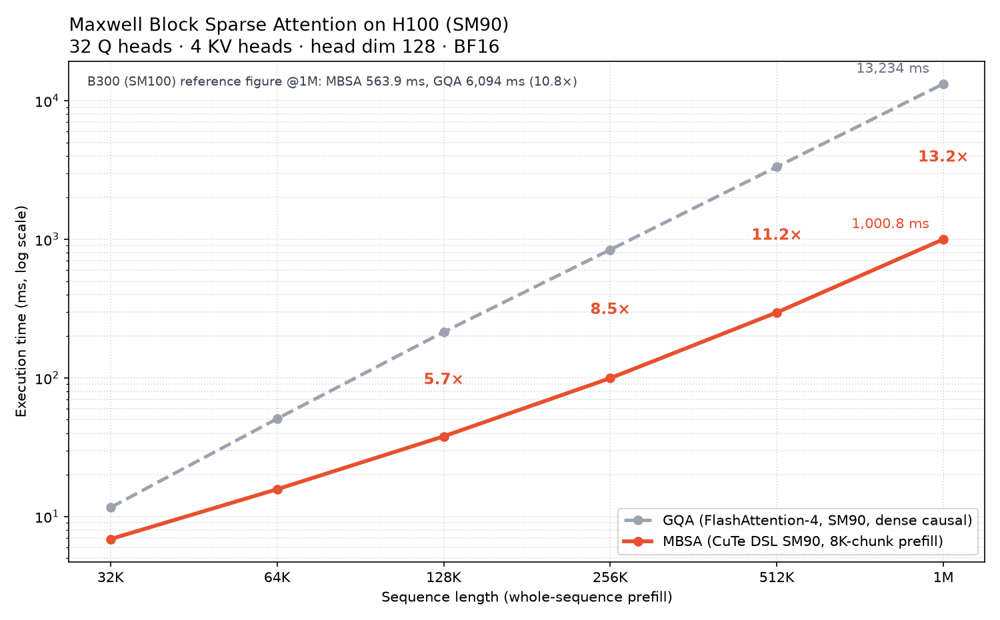

# Maxwell Block Sparse Attention (MBSA)

Maxwell Block Sparse Attention provides BF16 block-sparse prefill, organized after [MiniMax MSA](https://github.com/MiniMax-AI/MSA). The installable `mbsa` package provides a Python accuracy oracle, the retained Triton precision baseline, and the CuTe DSL performance runtime.


The Indexer selects remote KV blocks independently for four GQA groups. Two Attention paths consume the same main Q/K/V: **Fixed Attention** over Prefix-8 + SWA-8, and **Sparse Attention** over Remote Top-16. LSE-weighted state merging reconstructs attention over their union. Each KV block contains 128 tokens; main Q/KV have 32/4 heads and head dimension 128.

| Backend | Purpose | Public entry point |
|---|---|---|
| Python / PyTorch | Accuracy oracle extracted from the specified upstream Hugging Face model | `reference_pipeline` |
| Triton | Exact routing and fixed/dynamic attention for precision alignment | `triton_pipeline` |
| CuTe DSL | BF16 routing, Fixed BSA, KV-centric Dynamic MSA and state combine on B300 (SM103) and H100 (SM90) | `prepare_cutedsl_pipeline(...).run()` |

These are the three retained implementations. FP4/FP8 input kernels, standalone decode, TileLang and older experimental entry points have been removed. The BF16 CuTe runtime supports optional FP8 partial-output storage. Required BF16 MSA/Fixed BSA sources and the CUDA CSR metadata builder are bundled under `_vendor/`, with their licenses and notices preserved. [Architecture](docs/ARCHITECTURE.md), [Python source mapping](docs/MAXWELL_BLOCK_SPARSE_ATTENTION.md) and [provenance](PROVENANCE.md) describe the runtime and extraction boundaries.

## Performance


The supplied comparison uses 32 Q heads, 4 KV heads and dimension 128. At 1M, it reports MBSA at 563.865 ms, MSA* at 503.610 ms and GQA at 6,093.54 ms: approximately 10.8× faster than GQA and 12% higher latency than MSA*. The figure is supplied measurement data; it is not a new benchmark run of this refactor. The retained benchmark commands below report their own workload, precision checks and timings.

Historical measurements on one H100 80GB (SM90) in the `mbsa-h100:26.09` image, Q=8192, with the archived benchmark scripts ([details](docs/VALIDATION_H100.md)):

| KV | Triton e2e | CuTe DSL SM90 e2e | Speedup | CuTe DSL SM90, FP8 partials |
|---:|---:|---:|---:|---:|
| 8K | 5.36 ms | 1.20 ms | 4.5× | 1.04 ms |
| 32K | 6.50 ms | 1.98 ms | 3.3× | 1.72 ms |
| 128K | 10.30 ms | 3.06 ms | 3.4× | 2.78 ms |
| 1M | 67.17 ms | 14.28 ms | 4.7× | 14.36 ms |

Whole-sequence prefill on the same H100, compared with dense causal GQA from FlashAttention-4 (SM90): MBSA takes 99.5 ms vs 841.5 ms at 256K (8.5×) and 1,000.8 ms vs 13,233.5 ms at 1M (13.2×).



The CuTe timings flush L2 before each sample; the Triton script does not.

## Requirements

| Backend | Requirements |
|---|---|
| Python reference | Python ≥ 3.10, PyTorch ≥ 2.5; CPU or CUDA |
| Triton baseline | Linux CUDA host, BF16-capable GPU and Triton ≥ 3.6 |
| CuTe DSL runtime (SM103) | Linux, NVIDIA B300 / SM103, CUDA toolkit with `nvcc`, CuTe DSL ≥ 4.4.1 |
| CuTe DSL runtime (SM90) | Linux, NVIDIA H100 / SM90, CuTe DSL 4.8 (cu12 libraries), quack-kernels 0.6.2; no `nvcc` |

CuTe DSL compiles attention kernels on first use. On SM103, PyTorch's CUDA extension loader compiles the bundled CSR builder, so the CUDA toolkit and its headers must be available. No recursive submodule checkout or separate MSA installation is needed. Importing `mbsa` leaves optional accelerator runtimes unloaded.

## Install

```bash
# CPU reference, or standard installation with pip install .
pip install -e .

# Linux CUDA development environment
pip install -e '.[triton,cutedsl,dev]'
```

### H100 container

`docker/Dockerfile.h100` builds `mbsa-h100:26.09` from `nvcr.io/nvidia/pytorch:26.09-py3`. The NGC CUDA 13.4 stack cannot run on R550 (CUDA 12.4) hosts, so the image switches PyTorch, Triton, cuda-python and the CuTe DSL runtime libraries to CUDA 12 and copies this repository to `/workspace/mbsa`.

```bash
docker build -f docker/Dockerfile.h100 -t mbsa-h100:26.09 .
docker run --rm --gpus '"device=0"' --ipc=host mbsa-h100:26.09 \
  python examples/prefill.py --backend cutedsl --check
```

## Usage

All backends accept post-RoPE NHD tensors. Projection, normalization, RoPE and model KV-cache management belong to the caller.

```python
import torch
from mbsa import reference_pipeline

# A small CPU example with the production head layout.
q_tokens, kv_tokens = 32, 160
index_q = torch.randn(q_tokens, 4, 128, dtype=torch.bfloat16)
index_k = torch.randn(kv_tokens, 1, 128, dtype=torch.bfloat16)
q = torch.randn(q_tokens, 32, 128, dtype=torch.bfloat16)
k = torch.randn(kv_tokens, 4, 128, dtype=torch.bfloat16)
v = torch.randn_like(k)
output, lse, remote_route = reference_pipeline(index_q, index_k, q, k, v)
```

On CUDA, use the same tensors with the selected backend:

```python
from mbsa import triton_pipeline, prepare_cutedsl_pipeline

# Triton requires (kv_tokens - q_tokens) % 128 == 0.
output, lse, remote_route = triton_pipeline(index_q, index_k, q, k, v)

# Prepare once; run repeatedly with the same input tensor storage.
pipeline = prepare_cutedsl_pipeline(index_q, index_k, q, k, v)
output, lse, remote_route = pipeline.run()
```

Partial storage defaults to BF16. Set `MBSA_FP8_PARTIAL_OUT=1` for FP8 E4M3FN, or pass `partial_dtype=torch.float8_e4m3fn` explicitly. Explicit dtype takes precedence over the environment. Q/K/V and the final output stay BF16; LSE and reduction stay FP32.

The return shapes are output `[Q,32,128]`, natural-log LSE `[Q,32]` and remote block IDs `[4,Q,16]`. Unused route entries are `-1`; Prefix/SWA support is implicit. CuTe DSL supports logical KV tails, permuted Index-K pages and packed variable-length requests. See the [API contract](docs/ARCHITECTURE.md#5-api-contract) for paged layouts and request limits.

Runnable examples:

```bash
python examples/prefill.py --backend reference
python examples/prefill.py --backend triton --check
python examples/prefill.py --backend cutedsl --check
```

## Verify

```bash
python tests/test_precision.py
ruff check python examples tests tools

# Check wheel imports, the CPU oracle, bundled CUDA sources and notices.
python -m build
python tests/test_precision.py --wheel dist/mbsa-*.whl
```

CPU tests cover causal sparse GQA, negative index scores, per-group routes, cached offsets, KV tails, duplicate fixed support and the upstream BF16 probability cast. GPU tests compare the retained backends with the Python oracle and cover packed requests with permuted Index-K pages. CUDA tests skip explicitly on CPU hosts; CuTe tests require SM90 or SM103. The GitLab pipeline runs CPU, source and packaging checks; GPU qualification must run on a CUDA host.

[vLLM integration qualification](docs/VLLM_INTEGRATION.md) records real chunked-prefill/decode shapes, model A/B, exact interleaved cache-layout tests and controlled container comparisons.

[H100 validation](docs/VALIDATION_H100.md) records the SM90 image, 19 passing tests, the Triton/CuTe DSL comparison from 8K to 1M, the FA4 dense-GQA comparison, and the full BS32 operator matrix (19,968 records; every strict-gate failure is a near-tie route choice).

[B300 validation](docs/VALIDATION_B300.md) records 13 passing tests, isolated wheel GPU checks, permuted K/V page coverage and measured Triton/CuTe DSL timings on the refactored package.

[BS32 prefill qualification](docs/validation/bs32-refactor-20261004/index.html) records the final B300 run: 416 shapes × 48 options, all 19,968 strict HF gates passed, with zero remote-route differences. The native vLLM comparison retains 5,344 passes and 1,312 strict failures across 6,656 records. HF boundary refinement adds latency: for 385 same-GPU BF16 graph/warm unified pairs where both implementations pass, MBSA/native time-ratio median is 1.54. The report includes full samples, routing counts, source hashes and GPU-release evidence. Mixed decode requests reserve scheduler budget only; the operator executes prefill tokens.

The [previous BS32 report](docs/validation/bs32-20261004/index.html) preserves the earlier failures and diagnostics. Local SM90/H100 updates made during B300 testing are retained and listed separately in the new source audit; this B300 run does not qualify them.

## Accuracy and performance matrix

The live test surface is two files and one shared configuration:

- `tests/test_precision.py`: CPU/GPU contracts, source/wheel checks and full-query pinned-HF accuracy.
- `tests/benchmark_performance.py`: eager/graph timings, full precision gates, native vLLM comparison and host GPU monitoring.
- `tests/config.json`: prefill shapes, scheduler budgets, options, tolerances, sampling protocol and HF revision.

```bash
# Full-query accuracy; nonzero exit status preserves strict failures.
python tests/test_precision.py --matrix --hf-source /path/to/modeling_compass_moe.py \
  --output /tmp/mbsa-precision

# Run sequentially on the same empty GPU. Decode only reserves scheduler tokens.
python tests/benchmark_performance.py --hf-source /path/to/modeling_compass_moe.py \
  --output /tmp/mbsa-performance
python tests/benchmark_performance.py --backend native --partial-dtype bf16 \
  --hf-source /path/to/modeling_compass_moe.py --output /tmp/mbsa-native
python tests/benchmark_performance.py --backend native --partial-dtype fp8 \
  --hf-source /path/to/modeling_compass_moe.py --output /tmp/mbsa-native
```

Use `--case-id` for a focused regression, and performance `--shard-index` / `--shards`
for disjoint GPU shards. `--resume` preserves existing error records and continues unfinished
options in a fresh worker after a poisoned CUDA context. Timings exclude preparation/capture
and retain every sample. Historical experiments and executed source snapshots are archived in
[legacy-test-sources.tar.gz](docs/validation/legacy-test-sources.tar.gz).

## Layout

```text
python/mbsa/
  __init__.py                 lazy public exports
  reference.py                pinned Python accuracy oracle
  triton_backend.py           retained precision baseline
  cutedsl_backend.py          reusable CuTe DSL public plan
  vllm.py                     optional paged prefill/staged graph adapter
  cute/
    interface.py              routing, CSR, streams and state combine
    plan.py                   tensor and schedule ABI
    msa.py                    BF16 Dynamic MSA adapter
    src/sm103/router.py       BF16 block scores and exact Top-16
    src/sm103/merge.py        packed fixed/dynamic state merge
    sm90.py                   H100 plan: buffers, compiled kernels, streams
    src/sm90/router.py        WGMMA block scores and exact Top-16
    src/sm90/schedule.py      device-only KV-centric work schedule
    src/sm90/attention.py     Fixed, Dynamic and combine kernels
  _vendor/                    attributed minimal MSA and Fixed BSA runtime
examples/                     runnable prefill example
tests/test_precision.py       accuracy, CPU/GPU contracts and package checks
tests/benchmark_performance.py timings and native prefill comparison
tests/config.json              shared selected shapes and gates
tools/                        Chinese report renderer
docker/                       H100 image and smc sync helper
docs/                         architecture, source mapping and supplied figures
```

The Python oracle is pinned to upstream revision `d97a6c52967a5ed332e2196a5b985f0b4a475549`. Triton and CuTe DSL retain the MBSA runtime at revision `7490490`. [PROVENANCE.md](PROVENANCE.md) records source revisions, adaptations and third-party attribution.
