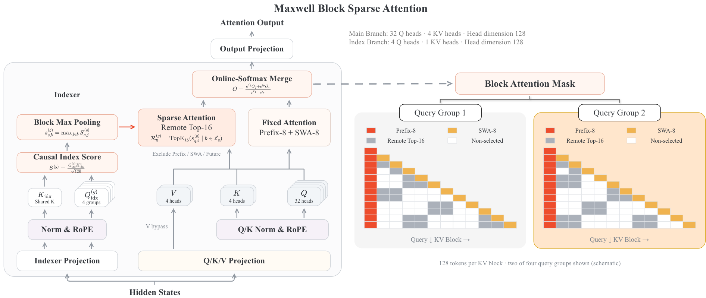

# Attention architecture and source map



## 1. Overview

The engineering layout follows [MiniMax MSA](https://github.com/MiniMax-AI/MSA): a `python/` package containing a small public surface and backend-specific internals, with a correctness entry point, a performance entry point and their shared config outside the package. The three public entry points share NHD inputs and `(output, lse, remote_route)` results. Lazy imports let the Python oracle run on a CPU without Triton, CuTe DSL or a CUDA driver.

Bundled runtime imports are relative to `mbsa._vendor`; loading CuTe DSL does not insert source folders into `sys.path` or register generic `src`, `interface` or `fmha_sm100` modules. The CUDA CSR builder remains lazy and its sources ship in the wheel.

| Component | File | Responsibility |
|---|---|---|
| Python oracle | `python/mbsa/reference.py` | Upstream per-group route selection and causal sparse GQA |
| Triton | `python/mbsa/triton_backend.py` | Exact hierarchical routing, tiled fixed attention, KV-grouped dynamic attention, FP32 state merge |
| CuTe public interface | `python/mbsa/cutedsl_backend.py` | Validate, allocate and prepare reusable execution |
| CuTe host flow | `python/mbsa/cute/interface.py` | Routing, CSR, streams, attention and final reduction |
| Plan ABI | `python/mbsa/cute/plan.py` | Route, page table, logical lengths and schedule ownership |
| Router | `python/mbsa/cute/src/sm103/router.py` | TMA/UMMA block-max scoring and exact Top-16 |
| Merge | `python/mbsa/cute/src/sm103/merge.py` | Final two-state reduction for packed requests |
| MSA adapter | `python/mbsa/cute/msa.py` | Native CUDA CSR/LPT and CuTe Dynamic MSA |
| Dependencies | `python/mbsa/_vendor/` | Minimal attributed Fixed BSA and MSA runtime |

## 2. Numerical contract

Index-Q has four group-specific heads and Index-K is shared. Each remote block score is the maximum eligible token dot product, scaled by `1/sqrt(index_dim)`. The upstream oracle does not apply ReLU. Prefix blocks and the most recent local blocks are excluded before selecting remote Top-16, so the attention support is the unique union of Prefix-8, SWA-8 and remote blocks. Every main attention token is additionally causal-masked.

The Python source computes logits/softmax in FP32, then casts probabilities to the value dtype before PV. It retains `torch.topk` tie behavior. Triton and CuTe use deterministic kernel tie breaking; equal-scored alternatives can select different blocks from Python. Random precision gates must avoid ambiguous ranking cutoffs, and adversarial ties require comparing selected score thresholds rather than assuming identical IDs.

For the production local-window setting, remote blocks are fully visible, allowing the CuTe Dynamic MSA consumer to use its noncausal fast path. The standalone Python oracle also supports `local_blocks=0`, where the current block must be token-masked during scoring. That configurable case is outside the retained accelerator contract.

## 3. Operators and dataflow

```text
Index Q/K → block-max score + local Top-16 → exact global Top-16
                                            ↓
                                      dynamic block IDs
                                            ↓
                                  KV-centric CSR + schedule
                                            ↓
Main Q/K/V ──────────────────────────→ Dynamic MSA → partial states
    └──→ implicit Prefix/SWA Fixed BSA ──→ fixed state
                                            ↓
                               K2 online-softmax state combine
                                            ↓
                                      output + natural-log LSE
```

SM103 CuTe scoring searches 1024 KV blocks per partition using TMA/UMMA. Tensor-core FP32 accumulation can differ from the upstream FP32 GEMM at the Top-16 cutoff, so the router retains block scores and merges approximate partition candidates before checking membership uncertainty. Conservative error intervals use `L1(Index-Q) * Linf(Index-K block)` and the FP32 sum error bound. A warp recomputes boundary blocks in HF dimension order only when an outside block could cross the cutoff; blocks provably above the uncertainty interval stay selected. The production path emits the final compact global IDs directly. The standalone partition-score API recomputes retained scores before its merge. This adds a block-score workspace (not a dense token-attention matrix), included in measured memory and latency.

CSR inverts query-to-block IDs into contiguous query lists for each `(KV head, KV block)`. Dynamic work reuses one KV block across routed queries. This metadata is built by a retained CUDA C++ extension; it is part of the performance path rather than an additional attention implementation.

Prefix/SWA support is generated from positions inside Fixed BSA. It needs no explicit fixed route. Batch-one K2 combine folds the fixed initial state and all dynamic partial states into the output. Packed requests use independent K2 dynamic reduction and a separate two-state merge. For KV ≤ 2048, fixed support covers every causal block and the dynamic branch is skipped.

## 4. Scheduling and preparation

For KV < 32K, native work records are reordered into 16 query-count buckets to reduce the final CTA wave's tail. Longer contexts use persistent CLC scheduling over native records. Compact batch-one metadata is selected from 32K onward.

Fixed BSA can overlap with scoring on a secondary stream. The retained length policy uses score-first ordering at 32K and 128K–256K; other batch-one lengths use fixed-first. Packed overlap defaults on through 8K and off for longer requests, where measured resource contention previously outweighed the saved launch gap.

Preparation owns prefix-sum validation, page-table validation, CSR scratch, partial-state buffers and events. Repeated `run()` calls reuse the attention and scheduling buffers. The SM103 router allocates temporary bound, candidate and block-score tensors through the PyTorch allocator; graph capture retains its own scratch storage. Those allocations and kernels are included in the eager/graph timings and peak-memory measurements. Packed requests keep request-local logical IDs; Index-K page tables resolve physical pages only during loading. Query/KV tails retain their logical bounds separately from padded physical pages. Packed requests use one launch over request-local query tiles for UMMA scoring, followed by one global boundary-refinement launch across the packed queries. Logical block IDs remain local to each request throughout the merge.

SM103 FP8 partial-state combine uses the existing cp.async load path. The
experimental TMA partial-state combine remains restricted to BF16: consecutive
FP8 shapes exposed graph/eager and strict HF discrepancies even when the remote
route matched. This dispatch restriction does not change the precision gates,
partial dtype, or FP32 state reduction.

Packed Fixed Attention consumes the request-tile descriptors in one launch,
including partial query tiles. Paged K/V permits positive D-row-aligned strides
from an interleaved vLLM pool. Same-geometry rebinding refreshes the routing
maps, Index-K view, main tensors and output aliases; logical lengths stay owned
by preparation. A captured plan keeps its original pointers and rejects rebinding.

## 5. API contract

```python
plan = prepare_cutedsl_pipeline(
    index_q, index_k_pages, q, k, v,
    cu_seqlens_q=cu_q,                 # CUDA int32 [B+1]
    cu_seqlens_k=cu_k,                 # CUDA int32 [B+1]
    index_page_indices=index_pages,    # active pages or padded request rows
)
output, lse, remote_route = plan.run()
```

Q is packed `[total_q,32,128]`; Index-Q is `[total_q,4,128]`. Packed Index-K uses physical `[pages,1,128,128]` storage. Main K/V can be packed `[total_k,4,128]`, or physical `[pages,4,128,128]` with `page_table`. Paged batch-one KV additionally supplies `logical_k_tokens`. Every request requires `0 < Q ≤ 8192` and `Q ≤ KV ≤ 1M`. A batch-one Index-K tail passed in NHD format is padded during preparation.

Triton uses the same batch-one flat interface, specialized to BF16, head dimension 128, GQA group eight, block size 128 and remote Top-16. Its fixed path requires a 128-token-aligned `KV-Q` query offset. The Python reference supports explicit `query_offset` for checking subsets of a cached chunk.

## 6. Validation

CPU tests compare sparse output with independently materialized causal GQA, check cached query offsets and partial KV blocks, preserve BF16 probability casting, and reject unsupported Index-K ownership. GPU tests align Triton and CuTe with the upstream Python source. The performance benchmark checks every prefill query against the pinned HF implementation, then records 19 CUDA-event and wall-time samples for both warm and cold L2, in eager and prepared-graph execution. It also verifies graph output after changing live query values.

CPU semantics and source/packaging checks can run on macOS. The CuTe runtime needs Linux CUDA / SM103 for fresh correctness and performance qualification. Moving sources and retaining kernel bodies alone does not establish a new GPU performance result.

[B300 validation](VALIDATION_B300.md) records the refactored package's GPU precision checks, paged and packed coverage, installed-wheel execution and representative timings.

The architecture figure describes model-level Attention dataflow. The operator flow above makes the retained multi-kernel Router, CSR, attention and reduction boundaries explicit; the drawing does not imply a single fused Attention kernel.

The Fixed TMEM load-reduction optimization requires complete packed-GQA query
tiles and full KV blocks in its qualified 16K–256K interval. Query/KV tails
use ordinary TMEM loads/software reduction; B300 tests cover Q=1/16/17 near
KV=16384/16385 to guard against waits in the optimized path.

## 7. H100 (SM90) path

`prepare_cutedsl_pipeline` dispatches SM90 devices to `python/mbsa/cute/sm90.py`. It keeps the public API, numerical contract and stage hooks (`run_score`, `run_plan`, `attention.run_fixed/run_dynamic/run_merge`) of the SM103 path, but every kernel is a CuTe DSL Hopper kernel (TMA + WGMMA, one producer warp and two consumer warpgroups). No CUDA C++ extension or `nvcc` is needed.

| Stage | File | Design |
|---|---|---|
| Router | `cute/src/sm90/router.py` | 256-query x 1 Index-head tile; each warpgroup issues two m64 WGMMA atoms per 128-token Index-K page, reduces rows to block maxima with quad shuffles and keeps an exact register Top-16 (one row per quad lane). A merge kernel combines partitions only when query tiles cannot fill the GPU. |
| Schedule | `cute/src/sm90/schedule.py` | Device-only counting sort: atomic histogram/rank per (KV head, block), single-CTA scan into equal work items of at most 160 queries, scatter of route-entry IDs. No host synchronization. |
| Fixed | `cute/src/sm90/attention.py` | 16 queries x 8 GQA heads per 128-row tile; Prefix-8 + SWA-8 blocks diagonal-first with online softmax, overlapping `S_i = QK_i` with `O += P_{i-1}V_{i-1}` inside each warpgroup; masks only diagonal and window-boundary blocks. |
| Dynamic | `cute/src/sm90/attention.py` | Persistent KV-centric CTAs load one routed K/V block per work item; each warpgroup processes independent 8-query chunks (per-query 8-row TMA gathers) and writes a normalized partial state per route entry (BF16, or FP8 E4M3FN). |
| Combine | `cute/src/sm90/attention.py` | One CTA per query folds the fixed state and up to 16 partials with FP32 LSE weights. |

Main K/V can be packed NHD `[total_k,4,128]` or physical pages `[pages,4,128,128]` with any 16-byte-aligned strides (vLLM's interleaved pool included); the schedule reads the live page table, so `rebind` only refreshes kernel arguments. Batch-one requests overlap Fixed attention with the Router on a secondary stream.

Dynamic and Combine are bounded by partial-state traffic: at Q=8192 the BF16 partials are about 1 GiB written and read once. FP8 partial storage halves that traffic. [H100 validation](VALIDATION_H100.md) records the image, tests and measured timings.
