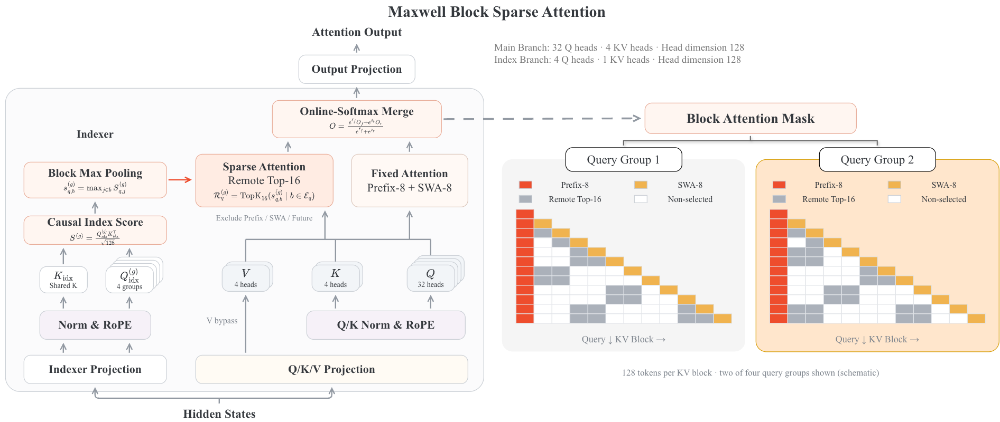

# Maxwell Block Sparse Attention: two paths

This figure focuses on Attention, following the supplied example's bottom-up projections, block selection and per-query-group mask panels. Key operators and Prefix blocks use Shopee orange (`#EE4D2D`); SWA blocks use amber (`#F0B34F`), and Remote blocks use gray (`#ABB1BA`). Projections use ivory or white, Q/K normalization uses pale lavender, and tensor nodes use pale blue-gray. Borders are muted; ordinary dataflow uses small open arrowheads with consistent card clearance and rounded bends. The right panels use horizontal rectangular mask cells, with 128 tokens per KV block. The filename is retained for existing references; decoder layers, mHC and MoE FFN are excluded.

Text uses Times New Roman to match the supplied line-chart reference; operator headings are bold and detail labels use regular weight. Equations use standard Times-style mathematical lettering with STIX fallback for mathematical symbols; draw.io retains editable LaTeX typesetting. Sparse Attention is positioned on the left and uses a stronger peach fill (`#FFECE3`); Fixed Attention is positioned on the right with a pale peach fill (`#FFF9F5`) and muted border. Fixed support connects directly to the shared main Q/K/V, while Indexer selection feeds only the Sparse path.

## The two Attention paths

| Attention path | Input and computation | Output / consumer |
|---|---|---|
| Fixed BSA | Shared main Q/K/V and position-derived Prefix-8/SWA-8 support | Causal fixed attention state `(O_f, LSE_f)` |
| Dynamic BSA | The same main Q/K/V and Indexer's remote Top-16 blocks → CSR → KV-centric MSA | Dynamic partial attention states |

The Indexer is routing preprocessing: detached hidden states → Index Q/K projection → Norm & RoPE → scaled dot product → 128-token block-max pooling → remote Top-16. Its request-logical block IDs feed Dynamic BSA; it is not counted as an Attention path.

Fixed BSA and Dynamic BSA share the main projection and post-RoPE tensors. They do not have separate learned Q/K/V projections. Their states are combined with online-softmax reduction; the merged attention output passes through `o_proj`.

The Maxwell Block Sparse Attention Python implementation constructs one union of Prefix/SWA/Remote blocks and computes sparse attention over that union. The two Attention paths in this figure describe the retained Triton/CuTe DSL execution split: fixed and remote supports are disjoint, and LSE-weighted merging reconstructs the same union softmax mathematically. This is a semantic mapping, not a claim that the upstream Python implementation launches two attention kernels. Backend rounding and tied Top-K scores still require precision checks on GPU.

The figure's formulas use group index `g`, query position `q`, KV block `b`, and token position `j`. Causally invalid index scores are set to negative infinity before 128-token block-max pooling. The eligible remote set `E_q` excludes Prefix, SWA and future blocks. In the merge formula, `ell_f` and `ell_r` denote natural-log LSE for the fixed and remote states; the implementation subtracts their maximum before exponentiation for numerical stability.

The logical state-merge box summarizes both retained runtime cases: batch one combines the fixed initial state directly in K2; packed requests first reduce dynamic partials with K2 and then use a separate fixed/dynamic merge. The [architecture documentation](ARCHITECTURE.md) expands those kernel boundaries and scheduling details.

## Projections and support

The main Q, K and V are drawn as separate tensor stacks: Q has 32 heads; K/V have four heads; head dimension is 128 and the GQA group size is eight. Q/K receive RMSNorm and RoPE, while V bypasses those operations. Both attention branches consume these main tensors.

The Indexer independently projects four group-specific Index-Q heads and one shared Index-K head from detached hidden states. It applies Q/K normalization and reuses the main branch's RoPE values. Token scores are raw dot products scaled by `1/sqrt(128)`, with no ReLU. Block-max pooling reduces each 128-token KV block to a score. Prefix, local-window and future blocks are excluded from the remote Top-16 selection.

Each group's full causal support is the unique union of Prefix-8, SWA-8 and its Remote-16. For readability, two of the four query groups are shown; each mask panel uses horizontal rectangular cells and shows 12 sampled query/KV block positions as a coarse schematic, rather than a complete contiguous mask. Sampling keeps one Prefix column and one SWA cell per row after the prefix region; this does not change the actual eight-block Prefix and SWA windows. The selection is computed using the full Prefix-8/SWA-8/Remote-16 support before sampling. Orange, amber and gray cells distinguish Prefix, SWA and Remote support; white cells inside the causal triangle are non-selected, and the blank region above the triangle is future support. Where Prefix and SWA overlap, the cell uses the Prefix color. Fixed support is shared across groups; remote support can differ. The remote routes are illustrative legal Top-16 selections, arranged as separate patches before sampling; they are not measured model routing scores. Short contexts may be fully covered by the fixed and available remote support.

## Source mapping

The source is [modeling_compass_moe.py](https://git.garena.com/shopee/llm/instruction-tuning/compass-training/compassv4_hf_assets/-/blob/d97a6c52967a5ed332e2196a5b985f0b4a475549/modeling_compass_moe.py), pinned to `d97a6c52967a5ed332e2196a5b985f0b4a475549`.

| Figure component | Implementation |
|---|---|
| Detached Indexer, shared Index-K, Q/K normalization and RoPE | Upstream `CompassMoeBlockSparseGQAIndexer`, lines 314–376 |
| Main Q/K/V projections, RoPE and output projection | Upstream `CompassMoeBlockSparseGQAAttention.forward`, lines 853–984 |
| Remote block selection and causal sparse attention | Upstream BSA methods, lines 492–851; local `reference.py` |
| Fixed / Dynamic execution and state merge | Local `cute/interface.py`, `cute/src/sm103/merge.py` and retained BF16 runtime |

## Editing and export

The prepared PNG is the figure used by repository documentation. Optional editable exports can be generated with `python tools/generate_attention_diagram.py` after installing `.[diagrams]`; it creates draw.io and SVG files under `docs/images/maxwell-block-sparse-attention-structure.*`. Mathematical Typesetting is enabled (`math="1"`), and operators, tensor stacks, arrows and individual mask cells are native editable shapes. Adding `--png` also overwrites the PNG preview. Diagram dependencies are separate from runtime dependencies.
