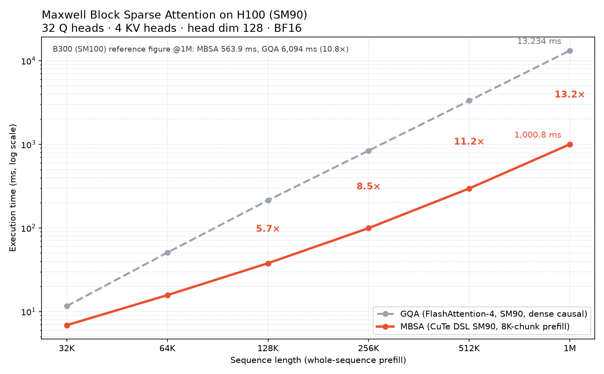

# H100 validation — 2026-10-04

本文记录历史执行快照。旧 benchmark/diagnostic 命令的源码已归档到
[legacy-test-sources.tar.gz](validation/legacy-test-sources.tar.gz)；当前入口为
`tests/test_precision.py`、`tests/benchmark_performance.py` 和 `tests/config.json`。


The SM90 CuTe DSL path was validated on host `10.249.32.139` (reached through `smc toc`) in image `mbsa-h100:26.09`, built from `nvcr.io/nvidia/pytorch:26.09-py3` with [docker/Dockerfile.h100](../docker/Dockerfile.h100). Raw logs are in [validation/h100-20261004](validation/h100-20261004).

## Environment

| Component | Version |
|---|---|
| GPU | NVIDIA H100 80GB HBM3, SM90 (one device) |
| NVIDIA driver | 550.90.07 (CUDA 12.4) |
| Base image | `nvcr.io/nvidia/pytorch:26.09-py3` |
| PyTorch / CUDA runtime | 2.9.1+cu126 / 12.6 |
| Triton | 3.5.1 (bundled CUDA 12.8 `ptxas`) |
| CuTe DSL | `nvidia-cutlass-dsl` 4.8.0.dev0, cu12 libraries |
| quack-kernels / cuda-python | 0.6.2 / 12.9.7 |

The NGC 26.09 user space is CUDA 13.4. An R550 driver cannot run it: CUDA 13 forward compatibility rejects that branch (`cuInit` error 803). The image keeps the NGC base but installs PyTorch cu126, cuda-python 12 and only the cu12 CuTe DSL libraries. It also points Triton at its bundled CUDA 12.8 toolchain, because cubins from the base image's 13.4 `ptxas` crash on load. The NGC driver-check banner is replaced with a short note.

## Correctness

- All 19 tests pass, with no skips (fresh container on GPU 1). The CuTe DSL tests now run on SM90. They cover fixed-only support, remote attention, KV tails, FP8 partial storage, packed requests with permuted Index-K pages, permuted paged K/V with a tail, vLLM's interleaved cache with Q=1/16/17 chunks, `rebind`, and the vLLM adapter in eager and CUDA-graph modes.
- `ruff check` passes. `tools/check_sources.py` reports only `docs/validation/bs32-20261004/index.html`, a README link from separate, uncommitted work.
- Benchmark precision gates sample the first and final 16 queries of every request. Route sets match the Python oracle exactly. The maximum output error is `4.9e-4` for BF16 partials (`1.6e-2` in the fixed-only 8K case, the same as Triton) and `3.9e-3` for FP8 partials. The maximum LSE error is `1.9e-6`.

## Performance

Q=8192, 32 Q heads, 4 KV heads, D=128, BF16. Medians use 3 warmups and 9 CUDA-event samples, excluding preparation and JIT. The commands are the repository's own benchmarks. `bench_cutedsl.py` flushes 256 MiB of L2 before each sample; `bench_triton_baseline.py` does not, and also includes per-call allocation and scheduling. All results below come from physical GPU 1, whose clocks stayed above 1.4 GHz at 66 °C or less.

| KV | Triton e2e | CuTe SM90 e2e (BF16 partials) | Speedup | CuTe SM90 e2e (FP8 partials) |
|---:|---:|---:|---:|---:|
| 8K | 5.361 ms | 1.200 ms | 4.5× | 1.038 ms |
| 32K | 6.497 ms | 1.977 ms | 3.3× | 1.721 ms |
| 64K | 7.462 ms | 2.342 ms | 3.2× | 2.065 ms |
| 128K | 10.299 ms | 3.062 ms | 3.4× | 2.776 ms |
| 256K | 16.588 ms | 4.564 ms | 3.6× | 4.267 ms |
| 1M | 67.166 ms | 14.283 ms | 4.7× | 14.364 ms |

CuTe SM90 stage medians with BF16 partials (ms):

| KV | Router | Schedule | Fixed | Dynamic | Combine |
|---:|---:|---:|---:|---:|---:|
| 8K | 0.079 | 0.055 | 0.421 | 0.438 | 0.287 |
| 32K | 0.384 | 0.088 | 0.470 | 0.705 | 0.414 |
| 64K | 0.743 | 0.080 | 0.471 | 0.729 | 0.415 |
| 128K | 1.465 | 0.066 | 0.475 | 0.779 | 0.415 |
| 256K | 3.173 | 0.089 | 0.506 | 0.860 | 0.415 |
| 1M | 12.465 | 0.296 | 0.513 | 1.415 | 0.415 |

The packed case (Q 777/1153, KV 33007/16641, permuted Index-K pages) runs in 0.594 ms end to end. Triton's 32K stage medians are router 1.283, schedule 0.304, fixed 1.780, dynamic 2.562 and merge 0.704 ms.

### Whole-sequence prefill vs dense GQA (FlashAttention-4)



This follows the [B300 figure](images/maxwell-block-sparse-attention-performance.png). Dense GQA runs one causal FlashAttention-4 call (`flash_attn.cute`, the FA4 code base; its SM90 forward, commit `e9515d5`) over Q=KV=L. MBSA prefills the same L tokens in 8192-token chunks; chunk *c* has Q=8192 and KV=8192·(c+1). Its time is the sum of per-chunk cold-L2 medians (`benchmarks/bench_long_prefill.py`). FA4 matches PyTorch SDPA within `3.9e-3` on a 4K causal prefix. The first and last MBSA chunks match the oracle exactly in route, with output errors of at most `9.8e-4`.

| L | MBSA (chunked) | GQA (FA4 dense causal) | Speedup | B300 figure speedup |
|---:|---:|---:|---:|---:|
| 32K | 6.9 ms | 11.6 ms | 1.7× | |
| 64K | 15.7 ms | 50.7 ms | 3.2× | |
| 128K | 37.9 ms | 214.3 ms | 5.7× | |
| 256K | 99.5 ms | 841.5 ms | 8.5× | 6.7× |
| 512K | 296.6 ms | 3,332.1 ms | 11.2× | |
| 1M | 1,000.8 ms | 13,233.5 ms | 13.2× | 10.8× |

On H100, dense FA4 reaches about 670 TFLOPS at 1M. MBSA scales almost linearly, because each query attends at most 32 blocks plus the Index-K scan. The speedup over dense attention is therefore larger on H100 than in the B300 figure. MBSA on H100 takes 1.78× its B300 time at 1M (1,000.8 vs 563.9 ms); dense GQA takes 2.17× its B300 time.

### Throttled GPUs

Physical GPUs 4 and 7 of this host throttle under sustained load: they run at 86–91 °C with SM clocks of 345–900 MHz (see `bs32/gpu-monitor.csv`). An earlier copy of this report ran on GPU 7; its timings are archived in [kv-sweep-gpu7-throttled](validation/h100-20261004/kv-sweep-gpu7-throttled) and are superseded. Short benchmarks there agree with GPU 1 within about 2%. The 1M router stage, however, varied between 12.7 and 18.4 ms on GPU 7; it is a steady 12.5 ms on GPU 1.

## BS32 operator matrix (Codex SM103 protocol)

The H100 path ran the same matrix that Codex used on B300 ([docs/validation/bs32-20261004](validation/bs32-20261004/README.md)), using `benchmarks/bench_bs32_matrix.py` unchanged except for accepting SM90. The matrix covers 416 configurations (413 prefill Q/KV geometries: 224 uniform, 192 built from mixed budgets, and single-prefill Q boundaries) at KV from 8K to 256K. Each configuration runs 48 options: BF16/FP8 partials × identity/permuted pages × overlap auto/off/on × eager/prepared CUDA graph × warm/cold L2. Every option uses 5 warmups and 19 alternating samples. The oracle runs the unmodified methods of the pinned HF source (`modeling_compass_moe.py`, SHA-256 `0209696b…`) on **every** prefill query. Main K/V are vLLM's interleaved page pool. Each graph is also replayed after changing live query values and compared bit-exactly with an eager run.

Shards ran on physical GPUs 0, 5 and 6; per-30-second clocks are in `gpu-monitor.csv.gz`. The shard first placed on GPU 4 was rerun on GPU 0 because GPU 4 throttles.

| Item | Result |
|---|---|
| Records | 19,968 of 19,968 (416 × 48); none missing; no error/OOM records |
| Strict HF gate | 17,280 passed, 2,688 failed |
| Checked queries | 1,981,569 per dtype (all queries); 7,926,276 query-heads |
| Route differences | 43 query-heads per dtype, each with exactly one block different (of 125,867,968 valid blocks) |
| Worst output / LSE | 0.0393 abs (tolerance ratio 1.29, only together with a route difference) / 0.0204 abs (ratio 0.74) |
| Live-query graph replay | bit-exact for every option |

All 2,688 failed records come from 103 configurations, each with a single route difference. None has an output or LSE violation without a route difference. Following Codex's procedure, `benchmarks/diagnose_bs32_routes.py` replayed the bf16/eager/warm/auto failures: 112 configuration–page-map pairs, 124 query-heads. The diagnosis script now recomputes the HF oracle when no oracle cache exists. Every differing block is a near tie: the HF FP32 score loss is at most 7.2e-7 (62 are exact FP32 ties), and the FP64 loss is at most 1.2e-6. With the MBSA route forced into HF's own attention, all 124 outputs pass (maximum tolerance ratio 0.029). The failures are tie-breaking, not attention error. For comparison, the B300 run has 3,792 route-tie failures and 74 output-only failures.

Latency compared with the B300 records, matched by configuration and option (19,248 pairs; ratio = H100 / B300, so values below 1 mean H100 is faster):

| Subset | Geomean ratio |
|---|---:|
| All paired records | 0.71 |
| BF16 eager / BF16 prepared graph | 0.68 / 0.76 |
| FP8 eager / FP8 prepared graph | 0.66 / 0.73 |
| Uniform 32-request family (graph, cold L2, BF16) | 0.63 |
| Mixed-budget family (graph, cold L2, BF16) | 0.94 (range 0.27–2.80) |

Large single requests remain faster on B300; for example, Q=8161/KV=8K takes 1.24 ms on H100 vs 0.71 ms on B300. Many-request packed batches are faster on H100. For example, 32 requests of Q=256 at KV=256K take 11.5 ms vs 20.8 ms, because the SM90 path routes, schedules and merges all requests in single launches. Summary: `bs32/summary.json` (written by `tools/summarize_bs32_matrix.py`); raw records: `bs32/results.jsonl.gz`.

The native-vLLM comparison (`bench_bs32_native.py`) needs vLLM, which this image does not contain, so it was not run on H100. The dense FA4 comparison above is the H100 baseline instead.

## Analysis

- **Router**: at 1M it runs at about 700 TFLOPS, close to practical H100 dense BF16 WGMMA throughput. The 256-query tile (two m64 atoms per warpgroup) halved Index-K L2 traffic, the earlier limit.
- **Fixed attention**: runs at about 570 TFLOPS. It overlaps S = QK with the previous PV inside each warpgroup and masks only diagonal and window-boundary blocks.
- **Dynamic + Combine**: bounded by partial-state traffic. About 1 GiB of BF16 partials is written and read once at Q=8192. Without partial stores, the dynamic kernel takes 0.32 ms at 32K. The measured write bandwidth on this H100 is 3.3 TB/s write-only and 2.6 TB/s read+write. FP8 partials halve the traffic and save 0.25–0.5 ms.
- **Experiments that did not help**: double-buffered router accumulators (register pressure), router/dynamic ping-pong scheduling, async bulk stores for partials, and running Fixed concurrently with Dynamic on a reduced persistent grid.

## Current test entry points

The measurements above are historical; the earlier FA4 experiment is outside
the current runtime image. Historical benchmark and plotting scripts are in
[the source archive](validation/legacy-test-sources.tar.gz), with SHA-256 in
[the archive index](validation/legacy-test-sources.json).

Build the current minimal SM90 image and run the two consolidated test entry points:

```bash
docker build -f docker/Dockerfile.h100 -t mbsa-h100:26.09 .
docker run --rm --gpus '"device=0"' --ipc=host mbsa-h100:26.09 \
  python tests/test_precision.py
# Mount the pinned HF source and a writable output directory for the matrix.
docker run --rm --gpus '"device=0"' --ipc=host \
  -v /path/to/hf:/hf:ro -v /path/to/output:/out mbsa-h100:26.09 \
  python tests/benchmark_performance.py --hf-source /hf/modeling_compass_moe.py \
  --output /out/mbsa
```

This recipe is the current image configuration; it has not been rebuilt for the
SM103 refactor. The preserved SM90 runtime and historical measurements above
remain separate from the new B300 qualification. All selected shapes and gates
come from [tests/config.json](../tests/config.json). Native vLLM comparison needs
a vLLM image; it is unavailable in this minimal H100 image.

Use an empty GPU and check its clock and temperature under sustained load.
The host can be reached through `smc toc`; [docker/sync_h100.sh](../docker/sync_h100.sh)
pushes the working tree through that connection.
